# InterviewX — All Final System Diagrams

**Status: Proposed final design; pending stakeholder sign-off.**

## D01 SYSTEM CONTEXT

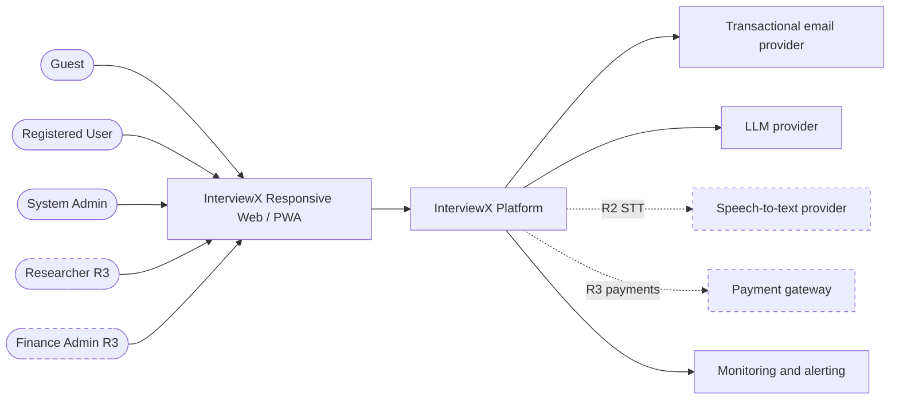

## D02 C4 CONTAINERS

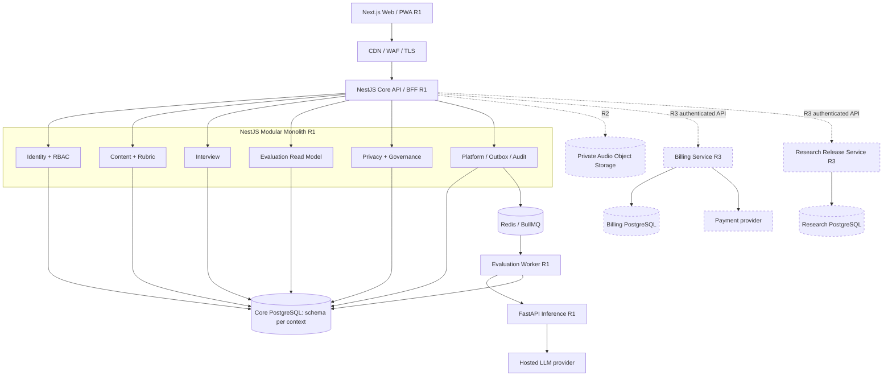

## D03 BOUNDED CONTEXTS

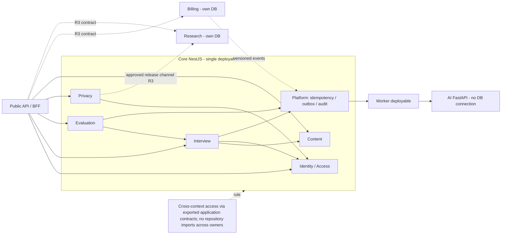

## D04 CORE ERD

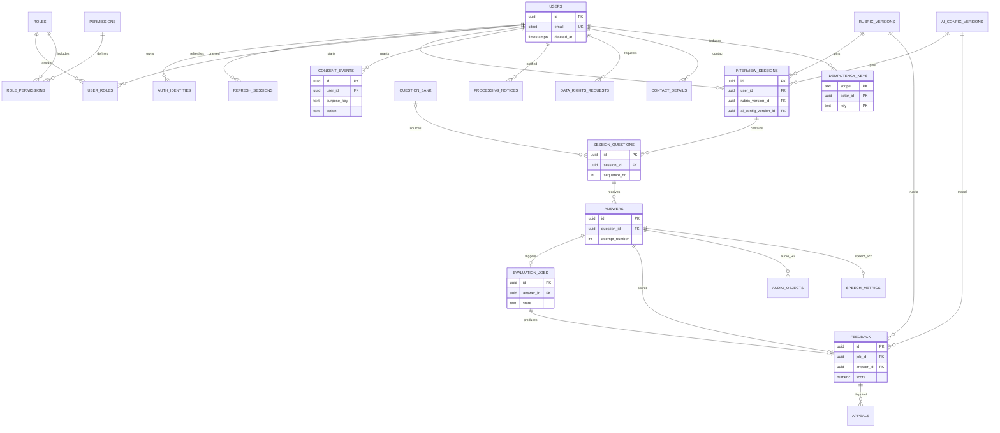

## D05 R3 ERD

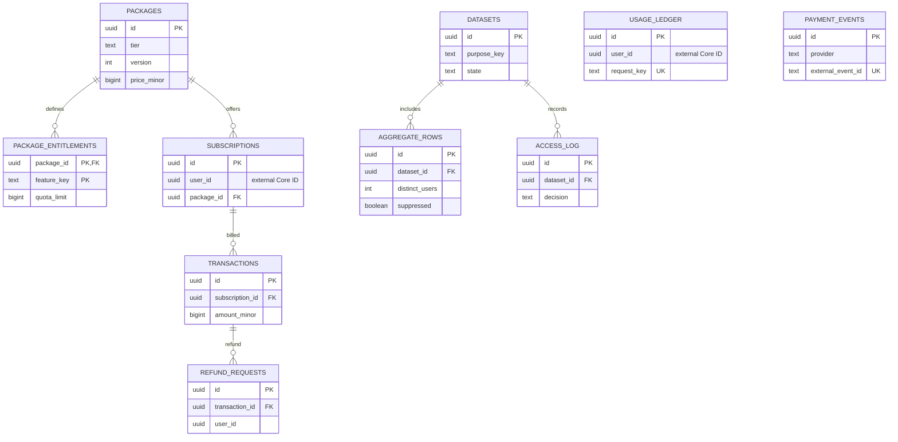

## D06 API TRUST

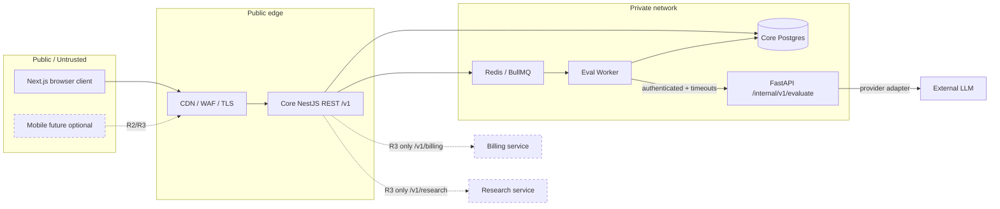

## D07 TEXT INTERVIEW SEQUENCE

```mermaid
sequenceDiagram
 autonumber
 actor U as User
 participant W as Web
 participant A as NestJS Interview API
 participant D as Core PostgreSQL
 participant O as Outbox dispatcher
 participant Q as Redis/BullMQ
 participant K as Evaluation Worker
 participant F as FastAPI AI
 participant L as LLM Provider
 U->>W: Submit text answer
 W->>A: POST /v1/interviews/{id}/answers
Idempotency-Key
 A->>A: Auth + ownership + state + content checks
 A->>D: BEGIN; insert answer, job, outbox, idempotency
 D-->>A: COMMIT
 A-->>W: 202 Accepted: jobId
 O->>D: Read undispatched outbox
 O->>Q: Enqueue stable event ID
 Q-->>O: Accepted
 O->>D: Mark dispatched
 Q->>K: Deliver at least once
 K->>K: Inbox/job-state deduplication
 K->>F: POST /internal/v1/evaluate with versions
 F->>L: Restricted provider call
 L-->>F: Untrusted candidate
 F->>F: Validate rubric, schema and evidence
 F-->>K: Validated feedback / needs-review
 K->>D: Atomic job transition + feedback result
 W->>A: GET /v1/evaluations/{jobId}
 A-->>W: pending / completed / failed / needs-review
```

## D08 EVAL STATES

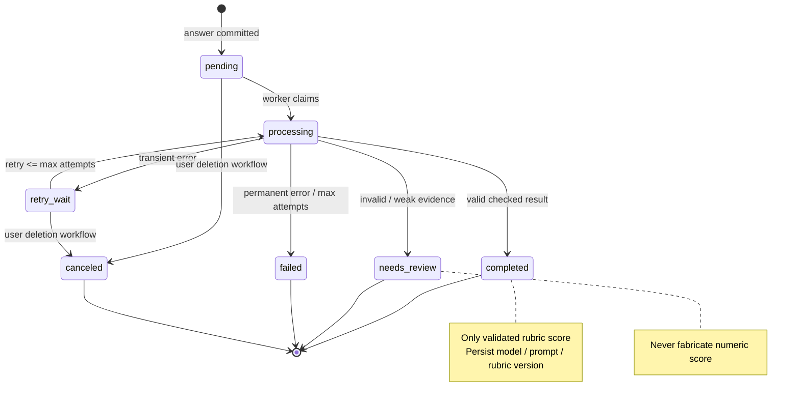

## D09 IDENTITY AUTHORIZATION

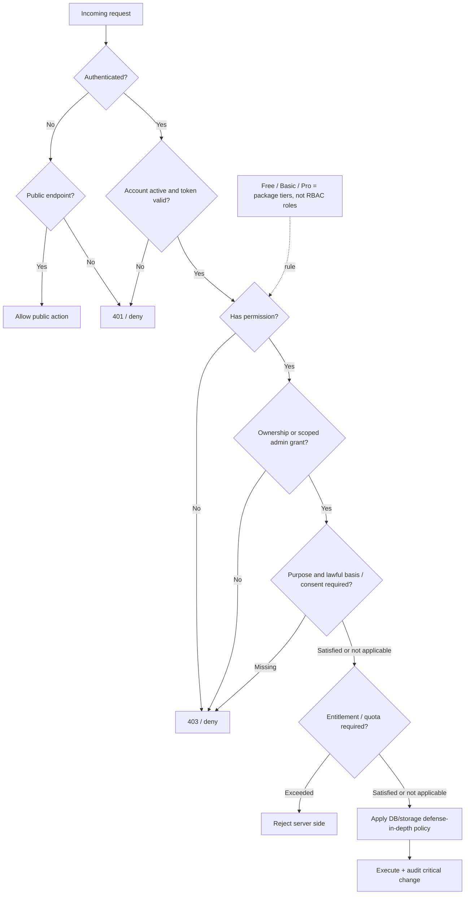

## D10 PRIVACY LIFECYCLE

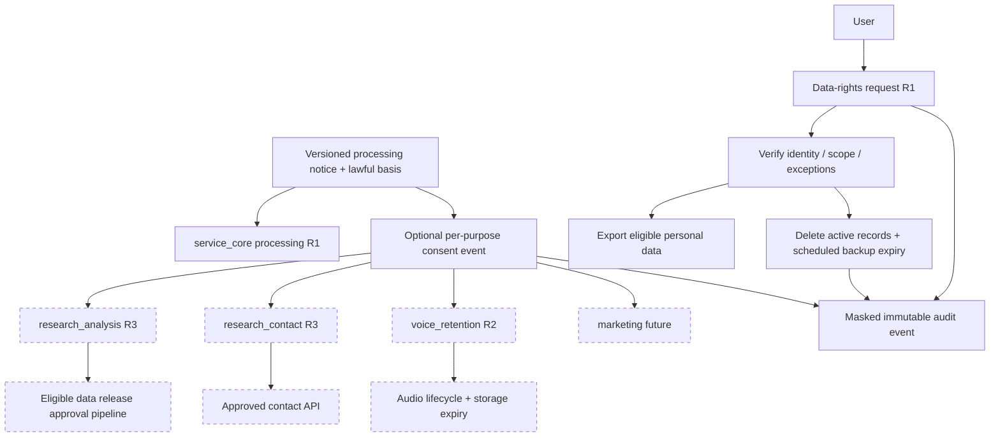

## D11 VOICE SEQUENCE R2

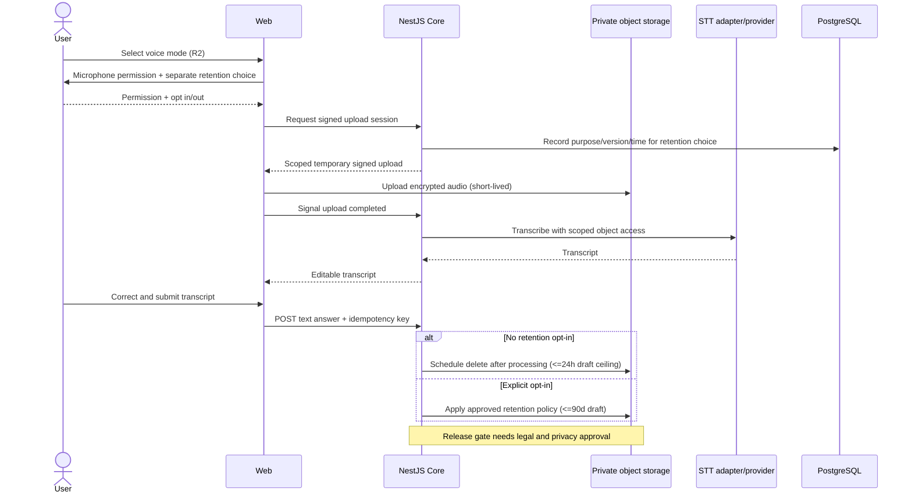

## D12 PAYMENT SEQUENCE R3

```mermaid
sequenceDiagram
 actor U as User
 participant API as API / BFF
 participant B as Billing Service R3
 participant G as Payment Gateway
 participant DB as Billing PostgreSQL
 participant C as Core Entitlement Integration
 U->>API: Checkout selection
 API->>B: Authenticated checkout request
 B->>DB: Snapshot published package price
 B->>G: Create hosted payment session
 G-->>B: Hosted checkout reference
 B-->>U: Gateway hosted redirect
 G->>B: Signed webhook event
 B->>B: Verify authenticity + provider event ID
 B->>DB: Atomic inbox + state transition + outbox
 alt Confirmed, new valid payment
  B->>C: Versioned entitlement-granted event
  C-->>B: Deduplicated fulfillment ACK
 else Duplicate or pending
  B->>B: No duplicate fulfillment
 end
 U->>API: GET payment status
 API->>B: Fetch authorized status
 B-->>U: pending / confirmed / failed
 Note over B,DB: Refund needs request -> approval -> execution; rules not approved
```

## D13 RESEARCH RELEASE R3

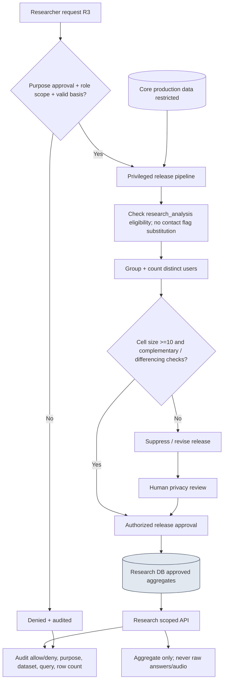

## D14 MANAGED PRODUCTION

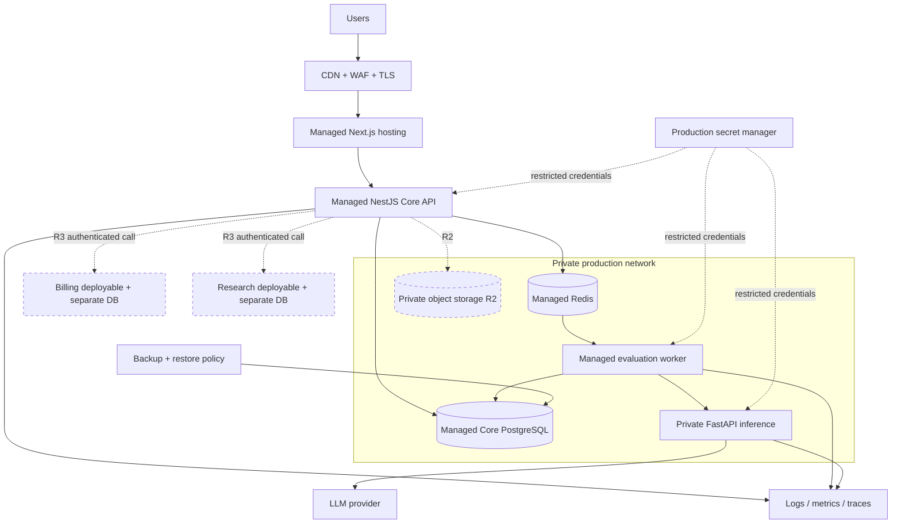

## D15 KUBERNETES SHOWCASE

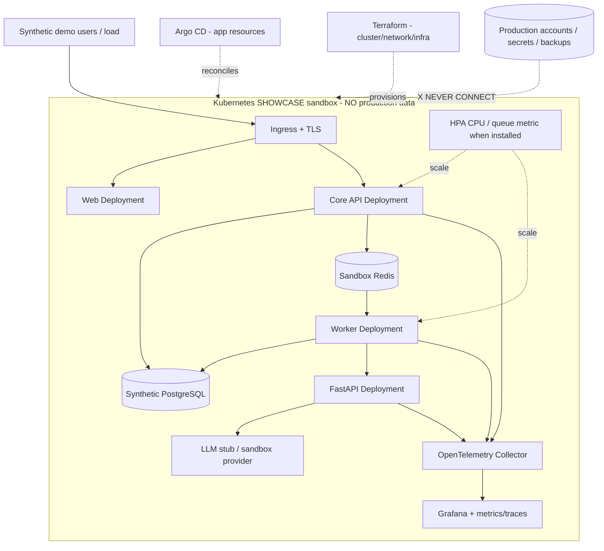

## D16 CI CD

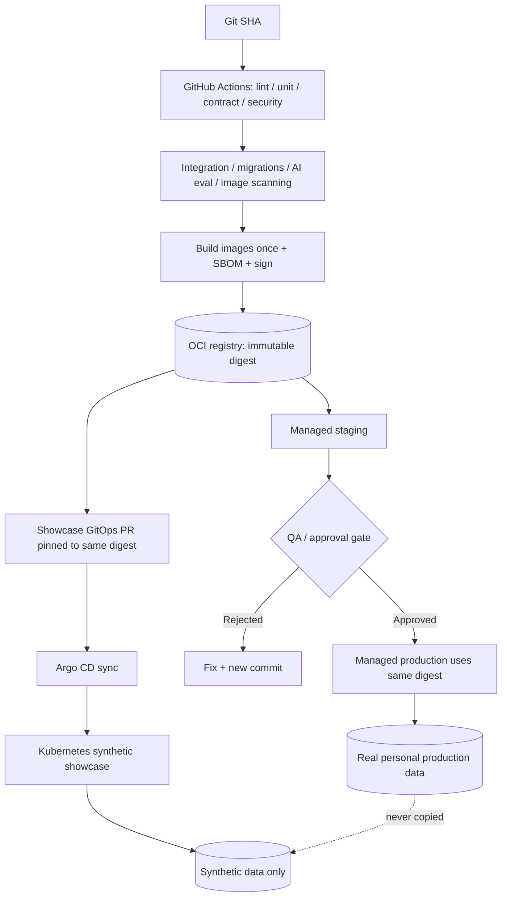

## D17 OBSERVABILITY RECOVERY

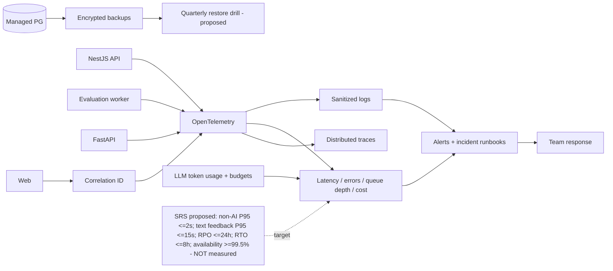

## D18 REPO BOUNDARIES

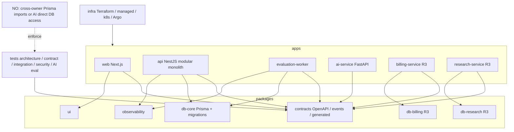

## D19 RELEASE ROADMAP

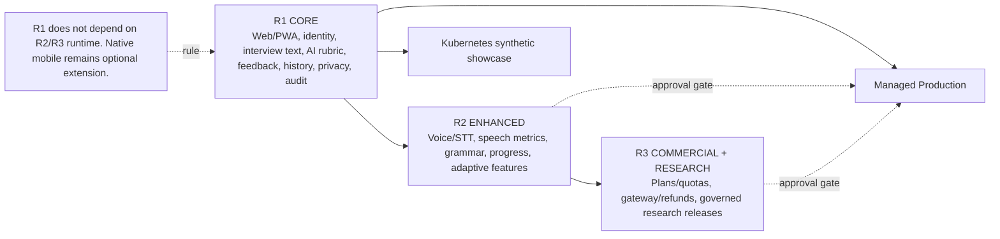

## D20 — Use Case Diagram (R1 design)

[Mermaid source](diagrams/D20_use_case.mmd)

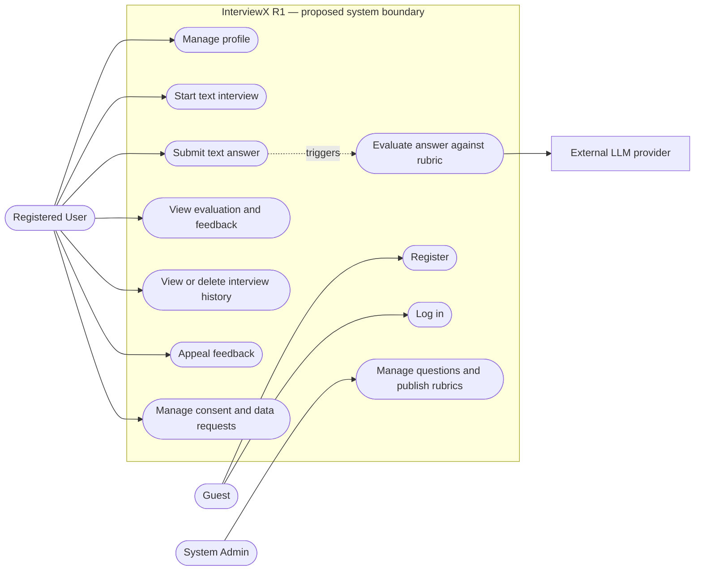

**Purpose:** แสดง actors และความสามารถที่ระบุไว้สำหรับ InterviewX R1.

**Scope:** Proposed R1 text interview; ไม่รวม R2 voice และ R3 billing/research.

**Actors:** Guest, Registered User, System Admin. LLM provider เป็น external dependency ของการประเมิน ไม่ใช่ผู้ใช้ระบบ.

**Explanation:** Guest เข้าถึง registration/login; Registered User ทำกิจกรรมฝึกและจัดการข้อมูลของตน; System Admin ดูแล content ตาม RBAC ที่เสนอ. เส้นประเป็นการกระตุ้น process ไม่ใช่ actor permission. ใช้ Mermaid flowchart เลียนแบบ UML use case; ไม่ใช่ strict UML.

**Assumptions and limitations:** การกำหนด permission รายละเอียดขึ้นกับ RBAC approval. ไม่แสดงผู้วิจัยหรือ Finance Admin เพราะเป็น R3. การเชื่อม LLM เป็น design dependency ไม่ใช่หลักฐานว่า deploy แล้ว.

**Source references:** [InterviewX_SRS_Final_For_Approval_v1.0.docx](../../03_SRS_Requirements/InterviewX_SRS_Final_For_Approval_v1.0.docx) (FR01/02/04/05/08/11/14/17/32–36); [public-v1.openapi.yaml](../interviewx-design/contracts/public-v1.openapi.yaml); [D01_system_context.mmd](diagrams/D01_system_context.mmd); [D09_identity_authorization.mmd](diagrams/D09_identity_authorization.mmd).

**Implementation status:** Proposed design, pending stakeholder sign-off; ไม่พบ InterviewX practice app implementation ใน repository นี้.

## D21 — User Flow Diagram (R1 design)

[Mermaid source](diagrams/D21_user_flow.mmd)

```mermaid
flowchart TD
  Entry[Web entry] --> Auth{Signed in?}
  Auth -->|No| Access[Register or log in screen]
  Access -->|Invalid input or credentials| Access
  Access -->|Success| Home[Practice home]
  Auth -->|Yes| Home
  Home --> Setup[Interview setup: job type and locale]
  Home --> History[Interview history]
  Home --> Profile[Profile and privacy]
  Setup -->|Start| Session[Text interview: question and answer]
  Setup -->|Cancel| Home
  Session -->|Invalid or empty answer| Session
  Session -->|Submit accepted| Pending[Evaluation pending]
  Pending -->|Still processing| Pending
  Pending -->|Completed| Feedback[Rubric score and feedback]
  Pending -->|Failed or needs review| Outcome[Status and next action]
  Feedback -->|Next question| Session
  Feedback -->|Appeal| Appeal[Feedback appeal]
  Feedback -->|Finish| History
  Outcome --> History
  History -->|Open own session| Feedback
  History --> Home
  Profile --> Home
```

**Purpose:** แสดงการนำทางของผู้ใช้เพื่อเริ่มฝึก ตอบคำถาม และดู feedback.

**Scope:** Proposed responsive web R1; screen names are logical UX labels, not verified Next.js routes.

**Actors:** Guest and Registered User.

**Explanation:** กล่องคือหน้าหรือสถานะ UI เชิงตรรกะ. การประเมินที่ backend ไม่ถูกจำลองเป็นหน้าจอ; D07 อธิบาย service exchange. History เปิด feedback ได้เฉพาะ session ของเจ้าของข้อมูล.

**Assumptions and limitations:** ชื่อและลำดับหน้าจอเป็น design-level inference จาก API/SRS; ยังไม่มี verified route map ของ InterviewX. การนำทางจาก history ไป feedback ของ session ที่ยังไม่มีผลต้องแสดง status ก่อนใน implementation. ไม่แสดง R2 dashboard หรือ R3 payment.

**Source references:** [InterviewX_SRS_Final_For_Approval_v1.0.docx](../../03_SRS_Requirements/InterviewX_SRS_Final_For_Approval_v1.0.docx) (FR01/04/05/08/11/14/17/36); [public-v1.openapi.yaml](../interviewx-design/contracts/public-v1.openapi.yaml); [D07_text_interview_sequence.mmd](diagrams/D07_text_interview_sequence.mmd); [D08_eval_states.mmd](diagrams/D08_eval_states.mmd).

Draft API accepts only interviewType=job and locale; additional category selection in the SRS remains unresolved.

**Implementation status:** Proposed UX flow, pending sign-off; screen routes unverified.

## D22 — Interview and Evaluation Activity (R1 design)

[Mermaid source](diagrams/D22_activity_workflows.mmd)

```mermaid
flowchart TD
  Start([Start])
  subgraph UserLane[Registered User]
    Choose[Choose job interview and locale]
    Write[Write and submit text answer]
    See[View status or feedback]
  end
  subgraph WebLane[Web]
    Show[Show question]
    Pending[Show pending state and poll]
  end
  subgraph CoreLane[NestJS Core and Core PostgreSQL]
    Create[Authorize and create session with pinned versions]
    Check{Valid answer, ownership and active session?}
    Reject[Return validation or authorization error]
    Commit[Atomic answer, job, idempotency and outbox commit]
    Read[Read owned evaluation status]
    Store[Persist checked result and job transition]
  end
  subgraph WorkerLane[Evaluation Worker and AI]
    Dispatch[Dispatch outbox via Redis/BullMQ]
    Assess[Worker calls FastAPI; validate provider result]
    Valid{Validated result?}
    Retry{Transient error and attempts remain?}
    Review[Mark needs_review or failed without invented score]
  end
  Start --> Choose --> Create --> Show --> Write --> Check
  Check -->|No| Reject --> Write
  Check -->|Yes| Commit --> Dispatch --> Assess --> Valid
  Valid -->|Yes| Store
  Valid -->|Invalid candidate| Review
  Valid -->|Provider error| Retry
  Retry -->|Yes| Assess
  Retry -->|No| Review --> Store
  Commit --> Pending --> Read
  Read -->|Pending| Pending
  Store --> Read
  Read -->|Terminal state| See --> End([End or continue session])
```

**Purpose:** แสดงการตัดสินใจและความรับผิดชอบใน text interview/evaluation lifecycle.

**Scope:** Proposed R1 core workflow; logical lanes describe responsibility, not independent deployables.

**Actors/components:** Registered User, Web, NestJS Core, Evaluation Worker, FastAPI AI, Core PostgreSQL, Redis/BullMQ.

**Explanation:** Core transaction ป้องกันคำตอบซ้ำและบันทึก job/outbox พร้อมกัน; worker รับงานแบบ at-least-once และตรวจผลก่อนบันทึก. สาขา failure อาจเป็น `failed` หรือ `needs_review` ตามชนิดข้อผิดพลาด. Web อ่านสถานะแบบ polling.

**Assumptions and limitations:** ไม่กำหนด retry count หรือ UI สำหรับ manual review เพราะยังไม่ตัดสินใจ. Existing D07 ให้ลำดับ message และ D08 ให้ state model; ภาพนี้เน้น decision/responsibility.

**Source references:** [public-v1.openapi.yaml](../interviewx-design/contracts/public-v1.openapi.yaml); [internal-evaluation.openapi.yaml](../interviewx-design/contracts/internal-evaluation.openapi.yaml); [001_core.sql](../interviewx-design/database/001_core.sql); [D07_text_interview_sequence.mmd](diagrams/D07_text_interview_sequence.mmd); [D08_eval_states.mmd](diagrams/D08_eval_states.mmd).

**Implementation status:** Proposed architecture, not verified as deployed.

## D23 — Data Flow Diagram: Context / Level 0 (R1 design)

[Mermaid source](diagrams/D23_data_flow.mmd)

```mermaid
flowchart LR
  User[Registered User] -->|Account, interview choices, text answers, privacy requests| Platform(InterviewX R1 platform)
  Platform -->|Questions, evaluation status, feedback, history, request status| User
  Platform -->|Scoped question, answer, rubric and model request| LLM[Hosted LLM provider]
  LLM -->|Untrusted evaluation candidate| Platform
```

**Purpose:** แสดงข้อมูลที่เข้า ออก และไหลระหว่าง core processes และ data stores.

**Scope:** Proposed R1 text interview/evaluation. Mermaid flowchart ใช้รูปแบบ DFD: rectangle = external entity, rounded node = process, cylinder = data store. ลูกศรแสดงข้อมูล ไม่ใช่ UI navigation หรือ control flow.

**External entities/components:** Registered User and hosted LLM provider; Web is a client channel of the user, not a separate data owner.

**Explanation:** Level 0 รวม InterviewX เป็น process เดียว; Level 1 ขยาย account, interview, evaluation, feedback และ privacy. Redis/BullMQ ขนส่ง outbox job ตาม D07 แต่ไม่ใช่ durable source of truth; `evaluation`/`platform` stores เก็บ job และ event. FastAPI ตรวจ LLM candidate; ไม่เข้าถึง Core PostgreSQL โดยตรง.

**Assumptions and limitations:** DFD นี้เป็น logical data flow. การใช้ `IdentityStore` รวม account/session records ไม่แสดง raw credentials. Privacy request processing หลังบันทึกยังขึ้นกับ policy. ไม่รวม R2 audio หรือ R3 data stores.

**Source references:** [public-v1.openapi.yaml](../interviewx-design/contracts/public-v1.openapi.yaml); [internal-evaluation.openapi.yaml](../interviewx-design/contracts/internal-evaluation.openapi.yaml); [001_core.sql](../interviewx-design/database/001_core.sql); [D02_c4_containers.mmd](diagrams/D02_c4_containers.mmd); [D07_text_interview_sequence.mmd](diagrams/D07_text_interview_sequence.mmd).

**Implementation status:** Proposed design, pending approval.

## D24 — Core Component Architecture (R1 design)

[Mermaid source](diagrams/D24_component_architecture.mmd)

```mermaid
flowchart LR
  Web[Next.js Web] -->|Public REST /v1| API[NestJS Core API / BFF]
  subgraph Core[NestJS Core — one modular monolith]
    Identity[Identity / Access]
    Content[Content]
    Interview[Interview]
    Evaluation[Evaluation read model and appeals]
    Privacy[Privacy]
    Platform[Platform: idempotency, outbox, audit]
  end
  API --> Identity & Content & Interview & Evaluation & Privacy
  Interview -->|Exported application contract| Identity
  Interview -->|Published question and version contract| Content
  Interview -->|Atomic submission contract| Platform
  Evaluation -->|Owned answer reference| Interview
  Evaluation -->|Job and audit contract| Platform
  Privacy -->|User identity contract| Identity
  Identity & Content & Interview & Evaluation & Privacy & Platform -->|Owning repository only| PG[(Core PostgreSQL, schema per context)]
  Platform -->|Outbox dispatch| Queue[(Redis / BullMQ)]
  Queue --> Worker[Evaluation Worker]
  Worker -->|Sanctioned job/result persistence adapter| PG
  Worker -->|Authenticated /internal/v1/evaluate| AI[FastAPI Inference]
  AI -->|Provider adapter| LLM[Hosted LLM provider]
```

**Purpose:** แสดง module dependencies ภายใน NestJS Core และ interfaces ที่เชื่อม worker/AI.

**Scope:** Proposed R1 modular monolith; R2/R3 omitted.

**Components:** Next.js Web, NestJS Core modules, Evaluation Worker, FastAPI Inference, Core PostgreSQL, Redis/BullMQ, hosted LLM.

**Explanation:** D02 ระบุ containers; D03 ระบุ bounded contexts. D24 เพิ่ม dependency ระหว่าง module และ interface ที่ข้าม process. Core modules อยู่ใน deployable เดียว; worker เป็น deployable แยกที่ใช้ persistence adapter ที่อนุญาต; FastAPI รับ scoped payload ผ่าน HTTP เท่านั้น.

**Assumptions and limitations:** ชื่อ module มาจาก proposed repository structure ไม่ใช่ source code ที่มีอยู่จริง. Connector ไป Core PostgreSQL แสดง schema ownership; ไม่อนุญาต cross-owner repository import. API/BFF ใช้ public contract ซึ่งยังเป็น draft.

**Source references:** [REPOSITORY_STRUCTURE.md](../interviewx-design/repo/REPOSITORY_STRUCTURE.md); [public-v1.openapi.yaml](../interviewx-design/contracts/public-v1.openapi.yaml); [internal-evaluation.openapi.yaml](../interviewx-design/contracts/internal-evaluation.openapi.yaml); [D02_c4_containers.mmd](diagrams/D02_c4_containers.mmd); [D03_bounded_contexts.mmd](diagrams/D03_bounded_contexts.mmd); [D18_repo_boundaries.mmd](diagrams/D18_repo_boundaries.mmd).

**Implementation status:** Proposed design, pending stakeholder sign-off; no corresponding InterviewX runtime modules found in this repository.

## D25 — Logical Domain Class Model — Design-Level

[Mermaid source](diagrams/D25_class_model.mmd)

```mermaid
classDiagram
  class User {
    +UUID id
    +string email
    +string accountStatus
  }
  class InterviewSession {
    +UUID id
    +string interviewType
    +string locale
    +string status
    +datetime startedAt
  }
  class SessionQuestion {
    +UUID id
    +int sequenceNo
    +string questionText
  }
  class Answer {
    +UUID id
    +int attemptNumber
    +string answerText
    +datetime answeredAt
  }
  class EvaluationJob {
    +UUID id
    +string state
    +int attempts
  }
  class Feedback {
    +UUID id
    +number score
    +map dimensionScores
    +list evidence
    +string status
  }
  class RubricVersion {
    +UUID id
    +string version
    +map criteria
  }
  class AiConfigVersion {
    +UUID id
    +string version
    +string modelIdentifier
  }
  User "1" --> "0..*" InterviewSession : starts
  InterviewSession "1" *-- "0..*" SessionQuestion : contains
  SessionQuestion "1" *-- "0..*" Answer : receives
  Answer "1" --> "0..1" EvaluationJob : queues
  EvaluationJob "1" --> "0..1" Feedback : produces
  InterviewSession "0..*" --> "1" RubricVersion : pins
  InterviewSession "0..*" --> "1" AiConfigVersion : pins
  Feedback "0..*" --> "1" RubricVersion : scoredWith
  Feedback "0..*" --> "1" AiConfigVersion : evaluatedWith
```

**Purpose:** แสดง logical objects ของ interview/evaluation R1 และความสัมพันธ์ที่ code จะใช้ได้ โดยไม่อ้างว่าเป็น implemented TypeScript classes.

**Scope:** Proposed R1 domain model. Attributes are selected from proposed physical schema and API contract; methods intentionally omitted because no InterviewX class implementation is available.

**Entities:** User, InterviewSession, SessionQuestion, Answer, EvaluationJob, Feedback, RubricVersion, AiConfigVersion.

**Explanation:** Session pins rubric/AI configuration at creation. Answer queues at most one job under the proposed unique constraint; completed job can produce one Feedback. `Feedback.score` may be absent for `needs_review`, although Mermaid does not express nullability. This is an object view of key domain data and version dependencies; D04 remains the physical ERD.

**Assumptions and limitations:** Class identifiers and camelCase attributes are logical projections of SQL/API names. Composition conveys lifecycle ownership at design level, not SQL cascade deletion. No methods or inheritance are asserted. The proposed SQL permits zero questions/answers and nullable score; these are reflected in multiplicities and prose.

**Source references:** [001_core.sql](../interviewx-design/database/001_core.sql); [public-v1.openapi.yaml](../interviewx-design/contracts/public-v1.openapi.yaml); [D04_core_erd.mmd](diagrams/D04_core_erd.mmd).

**Implementation status:** Logical Domain Class Model — Design-Level; not verified as implemented code.

## D26 — Data Flow Diagram: Level 1 (R1 design)

[Mermaid source](diagrams/D26_data_flow_level1.mmd)

```mermaid
flowchart LR
  User[Registered User] -->|Registration, login, profile input| Identity(1. Identity and access)
  Identity -->|Account and session records| IdentityStore[(identity schema)]
  IdentityStore -->|Identity and authorization data| Identity
  Identity -->|Owned user context| Interview(2. Interview practice)
  User -->|Category, locale, text answer| Interview
  ContentStore[(content schema)] -->|Published questions, rubric and AI config versions| Interview
  Interview -->|Session, question and answer| InterviewStore[(interview schema)]
  InterviewStore -->|Own history and answer context| Interview
  Interview -->|Question and history| User
  Interview -->|Evaluation job and outbox event| EvalStore[(evaluation and platform schemas)]
  EvalStore -->|Queued job and answer reference| Evaluate(3. Evaluate answer)
  InterviewStore -->|Question and answer text| Evaluate
  ContentStore -->|Pinned rubric and AI config| Evaluate
  Evaluate -->|Scoped evaluation payload| LLM[Hosted LLM provider]
  LLM -->|Untrusted candidate| Evaluate
  Evaluate -->|Validated result or review/failure state| EvalStore
  User -->|Status and feedback request| Feedback(4. Read evaluation)
  EvalStore -->|Job state and approved feedback| Feedback
  Feedback -->|Status, rubric scores and evidence-based feedback| User
  User -->|Consent or data-rights request| Privacy(5. Privacy requests)
  Privacy -->|Notice, consent event, request state| PrivacyStore[(privacy schema)]
  PrivacyStore -->|Recorded request and consent state| Privacy
  Privacy -->|Request status| User
```

**Purpose:** แสดงข้อมูลที่เข้า ออก และไหลระหว่าง core processes และ data stores.

**Scope:** Proposed R1 text interview/evaluation. Mermaid flowchart ใช้รูปแบบ DFD: rectangle = external entity, rounded node = process, cylinder = data store. ลูกศรแสดงข้อมูล ไม่ใช่ UI navigation หรือ control flow.

**External entities/components:** Registered User and hosted LLM provider; Web is a client channel of the user, not a separate data owner.

**Explanation:** Level 0 รวม InterviewX เป็น process เดียว; Level 1 ขยาย account, interview, evaluation, feedback และ privacy. Redis/BullMQ ขนส่ง outbox job ตาม D07 แต่ไม่ใช่ durable source of truth; `evaluation`/`platform` stores เก็บ job และ event. FastAPI ตรวจ LLM candidate; ไม่เข้าถึง Core PostgreSQL โดยตรง.

**Assumptions and limitations:** DFD นี้เป็น logical data flow. การใช้ `IdentityStore` รวม account/session records ไม่แสดง raw credentials. Privacy request processing หลังบันทึกยังขึ้นกับ policy. ไม่รวม R2 audio หรือ R3 data stores.

**Source references:** [public-v1.openapi.yaml](../interviewx-design/contracts/public-v1.openapi.yaml); [internal-evaluation.openapi.yaml](../interviewx-design/contracts/internal-evaluation.openapi.yaml); [001_core.sql](../interviewx-design/database/001_core.sql); [D02_c4_containers.mmd](diagrams/D02_c4_containers.mmd); [D07_text_interview_sequence.mmd](diagrams/D07_text_interview_sequence.mmd).

**Implementation status:** Proposed design, pending approval.
